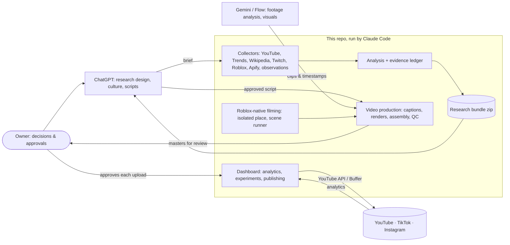

# Slugshot Marketing

**An AI-operated marketing production and research toolkit for *Slugshot*, a Roblox creature-combat PvP game in development.**

This repository is the working machinery behind Slugshot's short-form video marketing on TikTok, YouTube Shorts and Instagram Reels, in English and Spanish. It does two jobs:

1. **Make videos:** capture, narration, captions, vertical renders, multi-scene edits, automatic quality checks, and Roblox-native filming in an isolated copy of the game.
2. **Do research:** collect dated, labelled public data (YouTube, Google Trends, Wikipedia, Twitch, Roblox, TikTok public posts through Apify and Creative Center observations), check it, and turn it into findings that are traceable and evidence-led, rather than "AI vibes".

It is built to be **operated by an AI agent**. [Claude Code](https://code.claude.com/docs/en/overview) runs the toolkit from short natural-language instructions ("collect today's research", "is this meme still growing?", "make the Floppy duel edit"). ChatGPT designs research and writes scripts; Gemini/Flow analyses footage and generates visuals; the owner makes decisions and approves anything consequential.

> **Status, 26 November 2026.** Infrastructure is frozen and content production is underway. YouTube EN/ES, TikTok EN/ES and Buffer for TikTok EN/ES and Instagram EN were live-validated. Cloudinary hosting and Buffer draft creation were checked, and the first test posts await owner approval. Player analytics awaits launch. [Capability inventory](docs/INVENTORY.md) ? [Live validation](reports/archive/live-integration-validation-2026-11-25.md)

---

## How it fits together



- **Claude** collects, validates, computes, edits and films. It runs commands itself: the `ss` CLI is Claude's interface, not the owner's.
- **ChatGPT** owns research methodology, cultural interpretation and creative strategy.
- **The owner** approves spending, publishing, destructive operations and changes to the game repository; everything else that is free and reversible is pre-approved.

## What it can do

### Video production
| Capability | Command |
|---|---|
| Import OBS captures with a naming convention | `ss import` |
| AI narration (Kokoro, local) or recorded voice clean-up, music ducking, SFX | `ss voice`, `ss audio` |
| Whisper captions with automatic correction of Slugshot terms | `ss caption`, `ss fixcaps` |
| 1080×1920 renders from format presets (Remotion), variants, multi-scene edits synced to a script | `ss render`, `ss batch`, `ss assemble` |
| Gemini-timestamped clip candidates, frame sheets, technical QC (loudness, black/frozen frames, codecs) | `ss candidates`, `ss sheet`, `ss qc` |
| Timeline editing through MakeMyClip (confined to `media/`) | `ss clip` |

Creative judgement (pacing, cuts, captions, audio, formats) lives in a Claude skill with evidence-labelled rules: [`.claude/skills/slugshot-video-editing`](.claude/skills/slugshot-video-editing/SKILL.md).

### Roblox-native filming
Staged scenes and skits are filmed in an **isolated marketing copy** of the game, with DataStores disabled. A hook enforces that Claude's Roblox Studio MCP calls can only touch that place. Declarative JSON scene specs drive a scene runner (camera presets, timed actions, VFX/sound cues) and give repeatable takes. Details: [roblox-native/README.md](roblox-native/README.md).

### Research data collection
| Source | What it gives | Command |
|---|---|---|
| YouTube Data API | bilingual searches, regional gaming charts, creator uploads (ordinary ones too), comments, confirmed Shorts, per-video history | `ss yt` |
| Google Trends | Trending Now feeds for 7 markets; importer for Explore CSVs | `ss trends` |
| Wikipedia | daily page views back to 2015 in English and Spanish, redirects resolved | `ss wiki` |
| Twitch | Roblox clips and live streams by broadcaster language | `ss twitch` |
| Roblox | player/visit/favourite snapshots for a small watchlist | `ss rbx` |
| TikTok Creative Center, vidIQ, TinyFish, manual | validated public observations with provenance; a guided Creative Center session (you press Ctrl+A, Ctrl+C; it does the rest) | `ss observe` |
| TikTok through Apify | public-post collection for genre research | [Genre workflow](research/tiktok-genre/README.md) |
| One instruction | run a profile, then a bundle for ChatGPT | `ss research collect`, `ss research bundle` |

### Research intelligence
Turning data into findings that can be checked:
- **Bundle intake QC:** what each dataset is, its scope, expiry, missingness, rounding and what it *cannot* answer.
- **Deterministic analysis:** statistics with explicit denominators, same-item repeated observations, sensitivity checks (is the finding fragile?), trend dimensions kept separate (heat, velocity, breadth, persistence, novelty, fit) with a rule-based lifecycle proposal, change-point detection on long series, Wikidata/GDELT context.
- **Outcome-blind qualitative coding:** creative features are coded before performance is revealed, so "it went viral" can't contaminate "it has a good hook".
- **Evidence ledger:** every claim carries a level (observation → derived statistic → pattern → interpretation → causal → recommendation), a support status (supported / partially supported / unsupported / indeterminate), a verbal strength (exploratory → experimental) and exact references to bundle rows or quoted passages. A validator catches common overclaims, for example one snapshot called "accelerating", a Spanish search called "Mexican viewers", correlation written as causation, or a blank read as zero.
- **Literature verification:** installed skills check that cited papers exist and match their DOIs, and survey a field (OpenAlex, Crossref, Semantic Scholar, arXiv, dblp).

Commands: `ss analyze`, `ss evidence`. Guides: [research methods](docs/research-methods.md), [evidence ledger](docs/research-evidence.md).

### Personal dashboard
A local app (Desktop shortcut or `ss dash`) with five pages (Overview, Content, Publish, Roblox, Settings), styled after Jami with its night sky, in System (blue), Dark and Light. Minimum information by default; click a metric, account or video for detail. Standard-library Python + SQLite, loopback only, credentials encrypted with Windows DPAPI. Guide: [docs/dashboard/README.md](docs/dashboard/README.md).

- **Analytics** for our own accounts, from official owner-authorised APIs. Owner views label combined platform-reported counts. Share exports keep platforms separate, and missing values remain blank.
  - YouTube Analytics (EN, ES).
  - TikTok Display API (EN, ES).
  - Buffer (TikTok and Instagram post metrics; it only adds what the native APIs lack, so nothing is double-counted).
  - Roblox (after launch).
- **Content:** a gallery of produced videos waiting to post (play them in the app) and a gallery of published posts with their analytics, readings at 24 h / 48 h / 7 days, and creative tags from the codebook and knowledge banks.
- **Learning loop:** compare similar videos (one platform, same age, grouped by tag), record a finding as a draft knowledge-bank entry, and `ss kb brief` brings it into the next brief. Research, knowledge banks, sentiment and experiments run through `ss kb`, `ss evidence`, `ss analyze` and `ss sentiment` rather than dashboard pages; a snapshot exports for ChatGPT, Claude and Gemini.
- **Publishing** (`ss publish`, [docs/dashboard/publishing.md](docs/dashboard/publishing.md)):
  - YouTube uploads directly through its API. TikTok and Instagram go through Buffer, and Cloudinary's free plan briefly hosts the approved file behind a private signed link. Manual packages cover everything else.
  - **Only the owner approves an upload**, by typing the account handle. The approval binds the exact file and text.
  - Each upload re-checks that the connected account is the right one.
  - The **reveal lock** keeps the game unnamed in public posts.
  - Hosted copies are deleted after posting. Free-tier usage and Buffer's API allowance are shown in Settings.

## Principles built into the code

- **Missing is unknown, never zero.** Rounded figures stay as displayed, with their numeric value alongside.
- **Provenance on every row** (P1 platform count, P2 index/rank, P3 third-party estimate, P4 interpretation) and a run log with the exact parameters sent.
- **Provider rules are enforced, not just documented:**
  - YouTube statistics expire after 30 days, including exported copies, and are never aggregated across channels or turned into scores.
  - Twitch data is kept for 24 hours and stays local unless its export gate is enabled.
  - We have permission to use Apify for the toolkit's TikTok collection. A person reads Creative Center.
- **No composite "viral scores".** Heat and confidence are different things.
- **Retrieval is not audience.** A video found with a Mexico filter says nothing about Mexican viewers.
- **Rigour serves experiments, not paralysis.** Suggestive evidence can justify a cheap 15-second test; only our own experiments can support causal claims.
- **Credentials stay in a git-ignored `.env`** (or the DPAPI vault). They are never printed or logged, and errors and exports are redacted.
- **Nothing is published without the owner.** Claude prepares drafts and checks; the owner approves every upload in the dashboard. No scheduling or auto-posting, and free tiers only.

## Getting started

Requirements (Windows): Git, Python 3.13, Node 24, FFmpeg; OBS Studio and Kdenlive optional. Exact versions are in [docs/INVENTORY.md](docs/INVENTORY.md).

```powershell
git clone https://github.com/jarems421/slugshot-marketing.git
cd slugshot-marketing
py -3.13 -m venv .venv
.venv\Scripts\python -m pip install -r requirements.txt --extra-index-url https://download.pytorch.org/whl/cpu
py -3.13 -m venv .venv-tts; .venv-tts\Scripts\python -m pip install -r requirements-tts.txt   # optional AI narration
npm ci
copy .env.example .env    # research: YOUTUBE_API_KEY, TWITCH_CLIENT_ID/SECRET; dashboard and publishing: see below (all free tiers)
.\ss doctor               # tool check
.\ss smoke                # end-to-end smoke test -> reports\smoke-test.md
```

The Kokoro voice model and sample media aren't in the repo (they live in `models/` and `media/`, both git-ignored).

Dashboard and publishing credentials (the [credentials checklist](docs/dashboard/credentials-checklist.md) has every step):

- Google OAuth client: YouTube analytics and uploads.
- TikTok developer app: Login Kit and Content Posting.
- `BUFFER_API_KEY`.
- `CLOUDINARY_CLOUD_NAME` / `_API_KEY` / `_API_SECRET`.

Accounts are connected from the dashboard's Settings page. `.\ss dash hosting test` checks Cloudinary with a neutral test card.

### Using it
With Claude Code open in this folder, ask in plain language:

```text
Collect today's research.
Research Spanish Roblox comedy.
Is the Huss meme still growing?
Analyse our latest research bundle.
Find academic research on short-form hooks and verify the key findings.
Make a vertical edit of this match with the PVP preset and captions.
Refresh the dashboard and export a snapshot for ChatGPT.
Prepare this video for TikTok EN/ES and Instagram (I'll approve it in the dashboard).
```

Or run the commands directly: Python-backed commands show their options with `-h`. Full reference: [docs/COMMANDS.md](docs/COMMANDS.md); walkthrough: [docs/OPERATIONS.md](docs/OPERATIONS.md).

## Repository layout

```
ss.ps1 / ss.cmd          the CLI entry point (PowerShell)
scripts/                 production pipeline, research collectors, analysis, evidence ledger
remotion/                Remotion compositions (vertical template, multi-scene story)
roblox-native/           isolated marketing place builder, Studio guard, scene runner, scene specs
.claude/skills/          Claude skills: video editing, Roblox production, research operations,
                         research analysis + installed upstream research skills
config/                  formats, glossary, research settings, query families, watchlists, codebook
research/                evidence-ledger schema, templates, upstream provenance
docs/                    commands, inventory, research guides, policies, game truth and archives
dashboard/               personal dashboard: local server, connectors, metric rules, publishing, hosting, front end
tests/                   offline tests and fixtures (fake data)
jobs/                    example edit, variant and script files
reports/                 latest smoke-test reports
data/templates/          import templates (raw research data in data/local/ is git-ignored)
```

Not in git: `.env`, `media/`, `exports/`, `data/local/`, `models/`, `out/`, `vendor/`.

## Documentation

| Topic | File |
|---|---|
| Every command | [docs/COMMANDS.md](docs/COMMANDS.md) |
| Operator walkthrough, folders, CSV schemas | [docs/OPERATIONS.md](docs/OPERATIONS.md) |
| Status of every capability | [docs/INVENTORY.md](docs/INVENTORY.md) |
| Research collectors, data contract, sharing rules | [docs/research-data.md](docs/research-data.md) |
| Research methods / evidence ledger | [docs/research-methods.md](docs/research-methods.md) · [docs/research-evidence.md](docs/research-evidence.md) |
| YouTube API rules | [docs/youtube-api-policy.md](docs/youtube-api-policy.md) |
| Production quality, workflow and Flow / Gemini handoffs | [Production quality](docs/production-quality.md) |
| Game facts for marketing claims | [docs/game-truth.md](docs/game-truth.md) |
| Composio (read-only OAuth broker) | [docs/composio.md](docs/composio.md) |
| Knowledge banks / audience sentiment | [docs/knowledge-banks.md](docs/knowledge-banks.md) · [docs/audience-sentiment.md](docs/audience-sentiment.md) |
| Dashboard, credential setup and publishing | [Dashboard guide](docs/dashboard/README.md) · [Credentials](docs/dashboard/credentials-checklist.md) · [Publishing](docs/dashboard/publishing.md) |
| Historical documentation and reports | [Archive index](docs/archive/README.md) |
| Agent brief and working rules | [CLAUDE.md](CLAUDE.md) |

## Testing

- `ss smoke` runs 30 checks, including production, research and dashboard. The [latest full production report](reports/smoke-test.md) records 30 passes in its configured workspace.
- Research and dashboard smoke run 10 and 7 checks. Results depend on credentials, local evidence and the dashboard server. See the [research report](reports/smoke-test-research.md) and [dashboard report](reports/smoke-test-dashboard.md).
- The seven project offline suites contain 173 tests. Run each module in its own Python process to isolate fixture state:
  `Get-ChildItem tests/test_*.py | ForEach-Object { .\.venv\Scripts\python -m unittest ('tests.' + $_.BaseName) }`
- Test environment: numpy/ruptures use OpenBLAS, which on this machine can fail with "OpenBLAS error: Memory allocation still failed" at its default thread count. `scripts/research_analysis.py` sets `OPENBLAS_NUM_THREADS=1` by default; if another numpy script hits it, set `$env:OPENBLAS_NUM_THREADS = '1'` before running tests.

## Third-party components

| Component | Licence | Where |
|---|---|---|
| Buffer API, Cloudinary (free plans; used through their HTTP APIs, no SDK) | their terms of service | external services |
| Remotion | [Remotion licence](https://www.remotion.dev/docs/license) (free tier for individuals and small teams) | npm |
| MakeMyClip editor | MIT | npm |
| OpenAI Whisper | MIT | pip |
| Kokoro-82M model via kokoro-onnx | Apache-2.0 (model) | pip, model downloaded separately |
| ruptures, SciPy | BSD | pip |
| Reel (roblox-reel) | MIT | `roblox-native/runtime/vendor/Reel/` |
| remotion-dev/skills: remotion-best-practices | as published by Remotion (see `SOURCE.txt`) | `.claude/skills/remotion-best-practices/` |
| claude-skills-research: verifying-bibliography, surveying-literature | MIT | `.claude/skills/` (licence in `_shared/`) |
| synthesis-skills: synthesis-fact-checking | CC0-1.0 | `.claude/skills/` |
| K-Dense scientific-agent-skills: hypothesis-generation | MIT | `.claude/skills/` |
| EvidenceGuard schema and evals | MIT | `research/upstream/evidenceguard/` |

Pinned commits and adaptations: [research/upstream/PROVENANCE.md](research/upstream/PROVENANCE.md).

Slugshot, its characters and its game design belong to the game's owner. No licence has been chosen yet for this repository's own code. Slugshot is an original game and is not affiliated with Slugterra or its rights holders.
