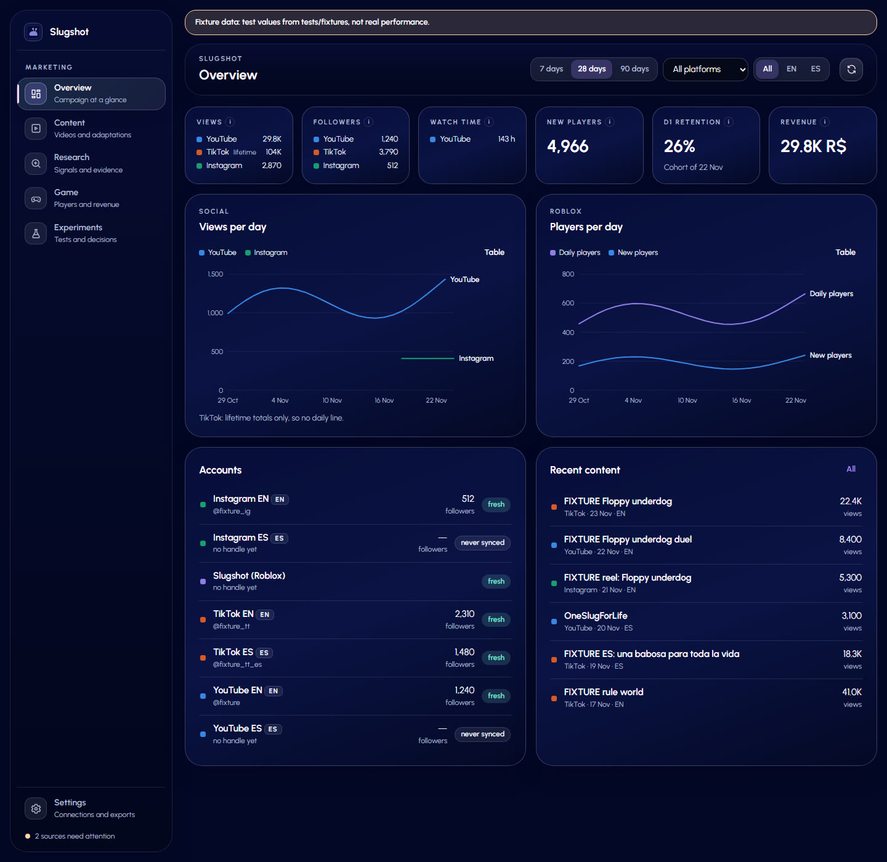
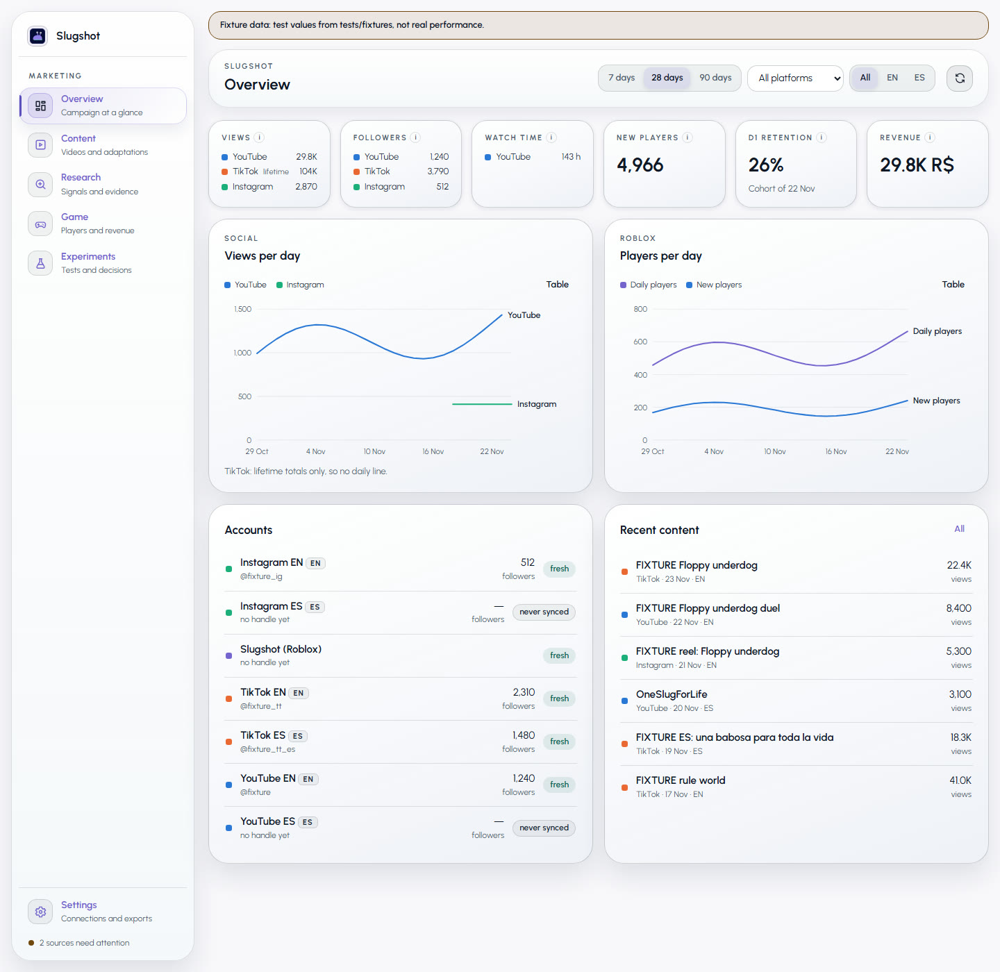
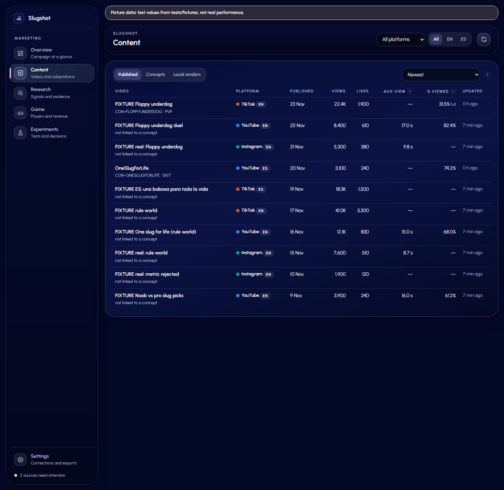
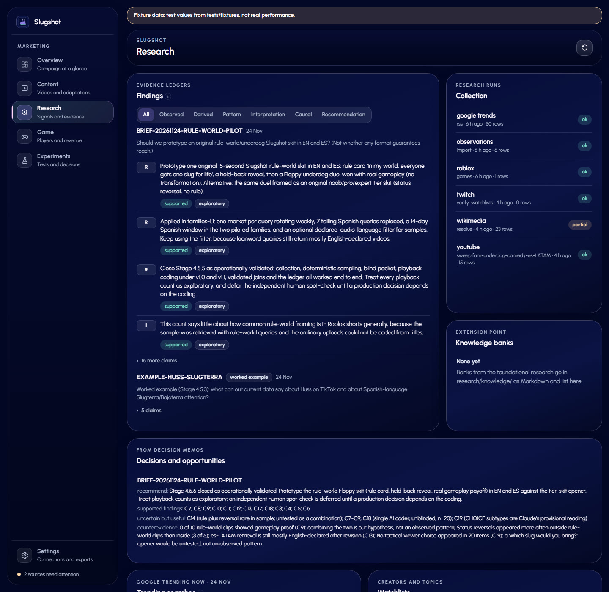
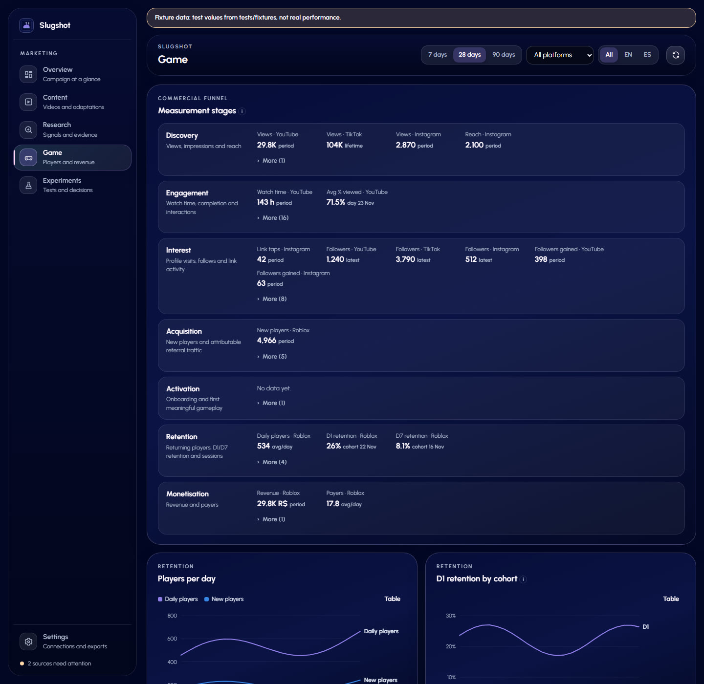
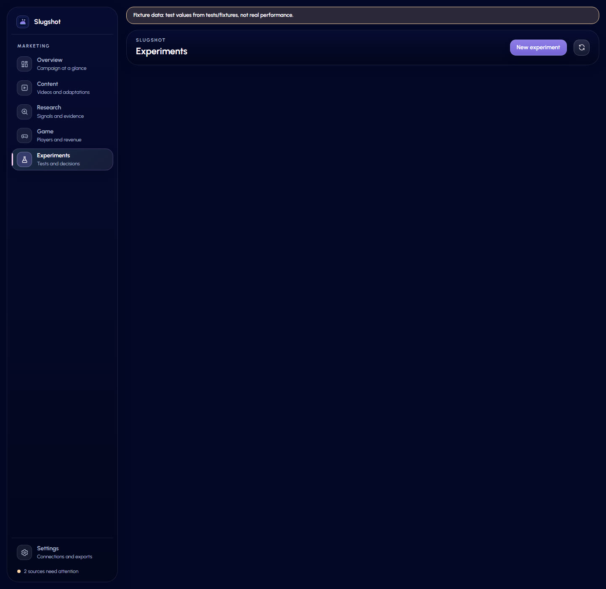
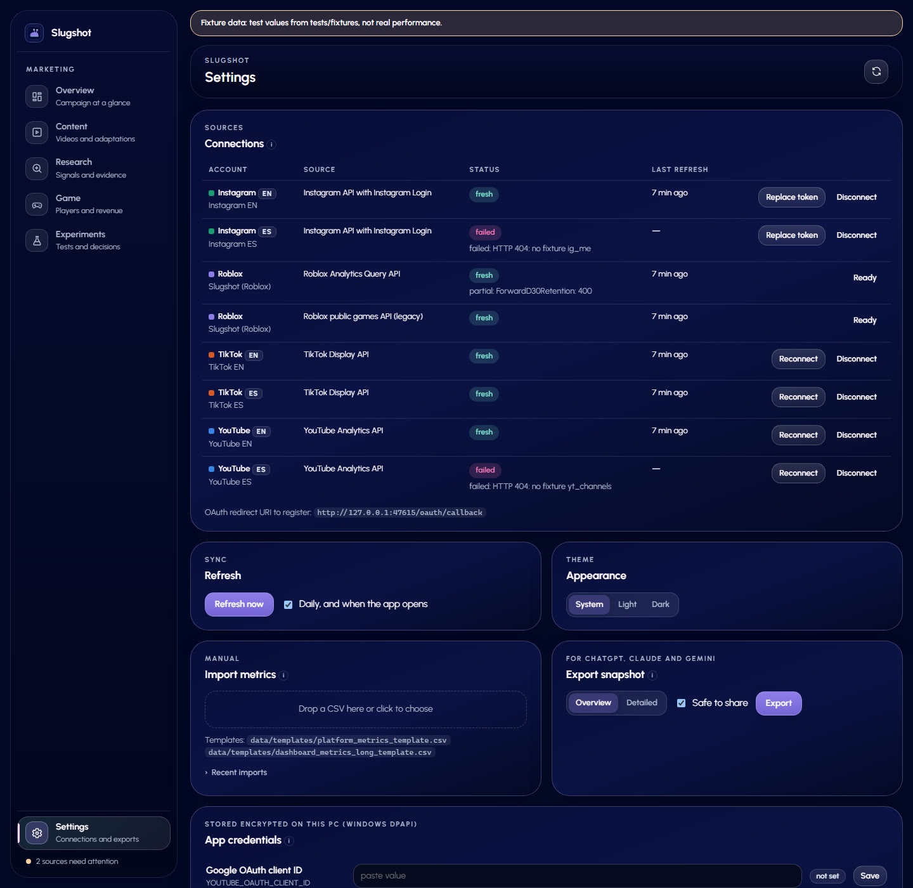
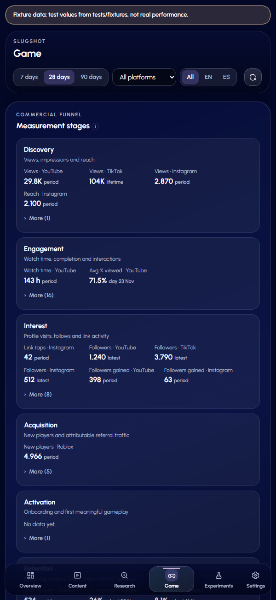
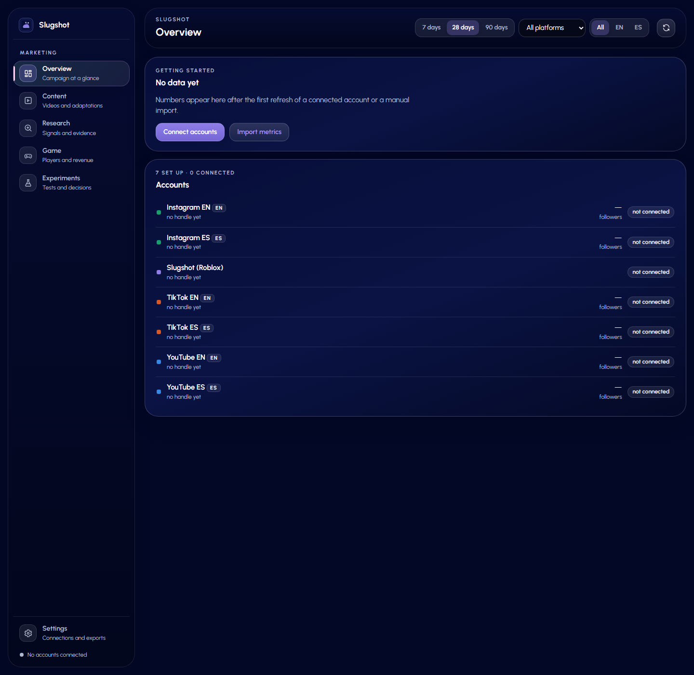
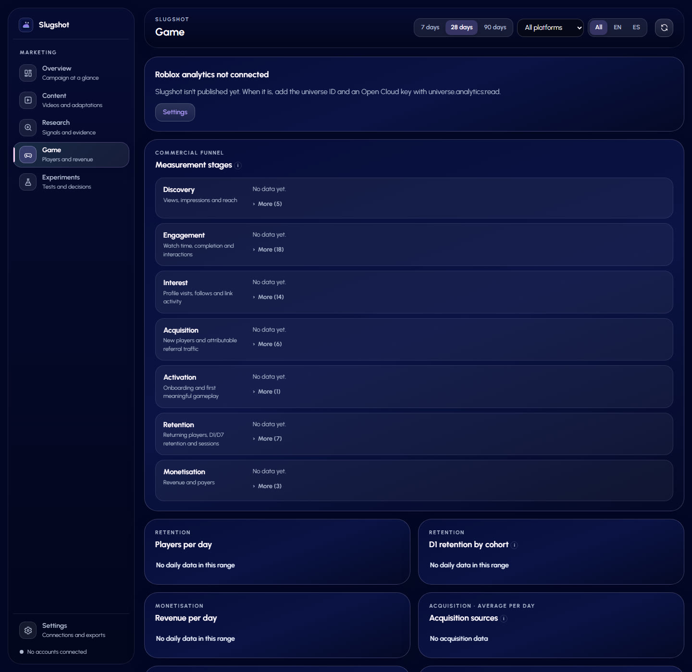

# Personal marketing dashboard: implementation report (25 Nov 2026)

## 1. What was implemented

- **A local dashboard app.**
  - Five pages: Overview, Content, Research, Game, Experiments; Settings sits in the sidebar footer.
  - Dark and light themes, and a phone layout with a bottom tab bar.
  - The design follows Jami (read-only reference, `jarems421/jami-flashcards` at `e23ce07`).
- **Commercial measurement framework.**
  - Seven separate measurement stages: Discovery → Monetisation.
  - Metric definitions with kinds and units (`config/dashboard/metrics.json`).
  - Rules in code: no cross-platform sums, `daily` metrics never summed, no conversion rates between stages.
- **Content registry with stable IDs** for concept → language version → platform upload, and experiments linked to versions.
- **Platform connectors**:
  - YouTube Analytics API v2 (with Data API v3 for the channel and its uploads), via OAuth;
  - Instagram API with Instagram Login, via a token the dashboard refreshes before it expires;
  - TikTok Display API, via OAuth;
  - Roblox Analytics Query API (API key; asynchronous queries are polled);
  - Roblox public games API (no key).
- **Synchronisation.**
  - Daily refresh, and a refresh on open when anything is stale; a manual refresh as well.
  - Re-reads the last 3 days on each run, deduplicates, and retries with backoff.
  - A failed source never stops the others.
  - Health and freshness are shown in the sidebar and in Settings.
- **Validated manual imports**, using the existing `platform_metrics` template plus a long template for anything no API provides.
- **Exports for ChatGPT, Claude and Gemini.**
  - Overview or detailed, as individually readable Markdown, CSV and JSON files (no ZIP).
  - Safe-to-share mode applies the sharing rules and strips local media paths.
  - Every file is scanned for credentials before the export is kept.
- **Launcher and app window.**
  - `ss dash` and Desktop/Start-menu shortcuts (already created) start the server in the background with no console window and open an Edge app window.
  - The dashboard can also be installed as a PWA.
- **Security.**
  - Loopback only, with Host and Origin checks and a per-start write token.
  - Exclusive port binding.
  - Write-only credentials, stored with Windows DPAPI.
  - All private data sits in git-ignored folders.
- **Seeded experiment `EXP-20261124-OPENER`** (rule-world vs tier-skit opener), status *proposed*, with no results.
- **Activation-events proposal** for the game. This is a proposal only; nothing in the game changed.

## 2. Screenshots

Fixture screenshots carry a "Fixture data" banner. Every figure in them is fake. The real dashboard is empty until accounts are connected.

| | |
|---|---|
| Overview (fixture, dark)  | Overview (fixture, light)  |
| Content (fixture)  | Research (real research store)  |
| Game (fixture)  | Experiments (real seed)  |
| Settings (fixture)  | Phone width (fixture)  |
| Real dashboard today: empty Overview  | Real dashboard today: empty Game  |

## 3. Install and launch

Already done on this PC: the **Slugshot Dashboard** shortcut is on the Desktop and in the Start menu.

- **Open it:** double-click the shortcut, or run `.\ss dash`.
- **Pin it:** right-click the Start-menu entry → Pin to taskbar.
- **Install as an app (optional):** in the window, `…` → Apps → Install.
- **Stop it:** `.\ss dash stop`.
- **See it with fake data:** `.\ss dash demo`, which opens on port 47616 and is labelled FIXTURE.

## 4. Architecture and important decisions

- **Stack:**
  - Python standard library server;
  - SQLite (`data/local/dashboard/slugshot.db`);
  - a build-free front end (one JS file, one CSS file and the Urbanist font, vendored under SIL OFL);
  - SVG charts with crosshair tooltips, legends, direct labels and a table view.
  - This adds **no new dependencies**, which matches the toolkit's standard-library convention.
- **One long-format observation table.** It keeps the source, provenance, observation time, period, breakdown, run ID and notes for every value.
- **Missing, unavailable, zero and stale are distinct:**
  - missing: no row;
  - unavailable: `status=unavailable`;
  - zero: a value of 0;
  - stale: judged from the observation time.
- **Snapshots:** day readings replace each other (late corrections), while lifetime readings keep every snapshot (growth).
- **Decisions made during the visual review:**
  - Daily players were being added across days, which counts returning players several times. This led to the new `daily` kind (shown per day or as an average).
  - The YouTube "% viewed" and TikTok "watched full video" columns were merged into one. They are now labelled separately.
  - Views are ranked only within one platform.
  - The Game page shows primary metrics first, with the rest behind "More".
- **Port:** a forgotten `python -m http.server 8765` from 23 Nov was found sharing the original port. Python's default `SO_REUSEADDR` allows that on Windows. The server now binds exclusively and uses 47615. The 8765 process was left running; it isn't mine to stop.
- **Research page:** reads `data/local/research` in place. Nothing is copied or re-collected.

## 5. Existing resources reused

- `research_common` (HTTP, redaction, `.env` reading, count parsing).
- The `platform_metrics` template shared with `ss export`.
- The research run log, evidence ledgers and decision memos.
- Google Trending Now, public observations, watchlists and codebook conventions (provenance P1–P4, blank never zero).
- `exports/` naming and QC files for local renders.
- The smoke-test framework (`ss smoke --dashboard`).
- The research skills' experiment method (one change; a predefined metric, window, stop rule and threshold).

## 6. External tools: adopted, deferred, rejected

| Option | Decision | Reason |
|---|---|---|
| YouTube Analytics API + Data API, Instagram API with Instagram Login, TikTok Display API, Roblox Analytics Query API | **adopted** (direct) | free, owner-authorised, no third party sees private analytics |
| Roblox legacy public games API | **adopted** | needs no key; already used by `ss rbx` |
| Roblox Studio MCP | used read-only | loaded the analytics-instrumentation guidance for the activation proposal; no Studio changes |
| Composio | **deferred** | for Instagram it still needs the same Meta OAuth, and it adds a third party and a plan cap |
| Google Drive / Claude Docs MCP | **deferred** | exports stay local; the owner uploads what they choose |
| TikTok API for Business / Business account | **rejected for now** | a Business account is limited to the Commercial Music Library; the Display API plus Studio imports cover the need |
| Scraping or browser automation of Studio pages | **rejected** | provider terms |
| Electron, Tauri, hosting, login, a UI or chart library | **rejected** | the Edge app window and PWA give an app-style window with nothing to maintain |

## 7. Tests and results

| Test | Result |
|---|---|
| `tests.test_dashboard`: 30 tests (store semantics, metric rules, connector fixtures, failure isolation, retry/no-retry, async polling, Instagram unavailable metrics, imports and row errors, duplicate files, exports, sharing rules, credential-leak abort, DPAPI vault, Host/Origin/token checks, path traversal, exclusive port, git-ignore and no secrets in tracked files) | **PASS** 30/30 |
| `ss smoke --dashboard` | **PASS** 3/3 ([report](smoke-test-dashboard.md)) |
| Existing suites `tests.test_research`, `tests.test_analysis` | **PASS** 53/53 |
| `ss smoke --research` (incl. live Wikimedia, Trends, Roblox, oEmbed, YouTube, Twitch) | **PASS** 10/10 |
| Roblox public connector against a public experience (throwaway DB, 1 request) | **PASS**, live-validated |
| Background launcher start and health check | **PASS** (about 1.2 s) |
| Real safe-to-share export from the empty real database | **PASS** (7 files, sources all "not connected") |
| Visual review: all pages, dark and light, 1440 px and 600 px, real empty state | reviewed; issues found were fixed (see §4) |

Not run: the full `ss smoke` (Whisper, Kokoro, Remotion renders). No production code changed there; only the smoke script gained the dashboard group.

## 8. Automated, manual or unsupported

| | Automated (once authorised) | Manual import | Unsupported / blocked |
|---|---|---|---|
| YouTube | daily views, watch time, avg view duration, avg % viewed, subs gained/lost, likes, comments, shares; per-video totals; uploads list; subscriber count | impressions and click-through (Studio), link taps | none |
| Instagram | followers; daily views, reach, link taps, follows/unfollows; per-reel views, reach, likes, comments, shares, saves, avg/total watch time | profile visits | follower count needs 100+ followers |
| TikTok | followers; per-video views, likes, comments, shares (lifetime) | watch time, avg duration, watched-full %, saves, profile visits, daily views (TikTok Studio) | daily series through the API |
| Roblox | daily players, new players, D1/D7/D30 cohorts, session length, visits, revenue, payers, payer conversion, players by acquisition source; public visits/playing/favourites | share-link visits and new players | activation (needs game events), until the game is published |

## 9. Remaining blockers and limitations

- **No live platform data yet.** Every own-account connector is fixture-tested against documented response shapes. The first live run of each may surface an API detail to adjust (most likely: the Instagram Graph API version in settings, TikTok's loopback redirect rule, and how Roblox labels `IsNewUser` values).
- **Game:** Slugshot is unpublished, so the Roblox analytics, share links and activation stage wait on publishing, which is the owner's decision.
- **TikTok:** production use needs TikTok's app review; Sandbox works for the owner's own accounts.
- **Sharing:** own-account analytics are included in safe-to-share exports by default. This needs the owner's confirmation (checklist item 6).
- **Research tooling:** Composio and Deep Research weren't used.
- **Exploratory evidence:** the seeded experiment's evidence base is exploratory, and its threshold is ChatGPT's to set.

## 10. Credential and account-authorisation checklist

The full table (product, official URL, account type, credential, how to get it, where it goes, mandatory or optional, what it unlocks) is in [docs/dashboard/credentials-checklist.md](../docs/dashboard/credentials-checklist.md). In short:

1. **YouTube.** In the existing Google Cloud project:
   - enable the YouTube Analytics API;
   - publish the OAuth consent app;
   - create a Desktop OAuth client.
   Then paste the client ID and secret in Settings, and Connect each channel. Optional; recommended first.
2. **Instagram.**
   - Switch each account to Professional → Creator.
   - Create a Meta app with "API setup with Instagram login" and add both accounts as Instagram Testers.
   - Generate a token per account and paste it in Settings.
   Optional.
3. **TikTok.**
   - Create a developer app with Login Kit and the Display API.
   - Add the scopes `user.info.basic`, `user.info.stats` and `video.list`.
   - Add both accounts as Sandbox target users and register the redirect URI.
   - Paste the key and secret, then Connect.
   Production use needs app review. Optional.
4. **Roblox** (after publishing).
   - Enter the universe ID in Settings → Accounts.
   - Create an Open Cloud key with `universe.analytics:read` and paste it in Settings.
   Optional; needed for the Game page.
5. **Roblox share links.** Create one per account or campaign and import their figures.
6. **Decide:** sharing defaults for exports.
7. **Decide:** whether to approve the activation-events proposal (a game change).

Redirect URI for every OAuth client: `http://127.0.0.1:47615/oauth/callback`. Nothing here costs money.

The ChatGPT/Gemini handoff is regenerated: [docs/chatgpt-handoff-dashboard.md](../docs/chatgpt-handoff-dashboard.md), and the docs pack (`exports/share/chatgpt-pack/Slugshot-Claude-Toolkit-Docs.md`, 54 files) includes the dashboard docs.

Nothing was committed, pushed, published or spent. The game repository and Jami were only read.
